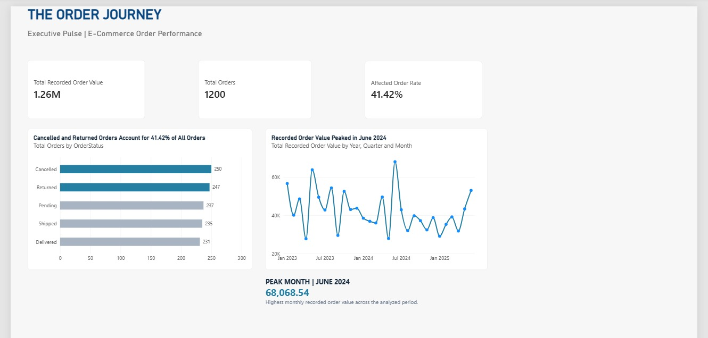
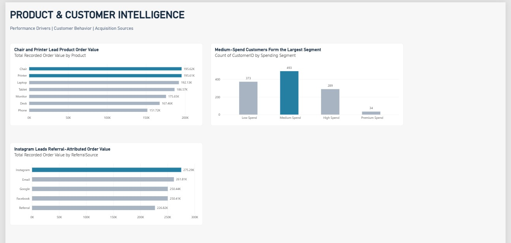
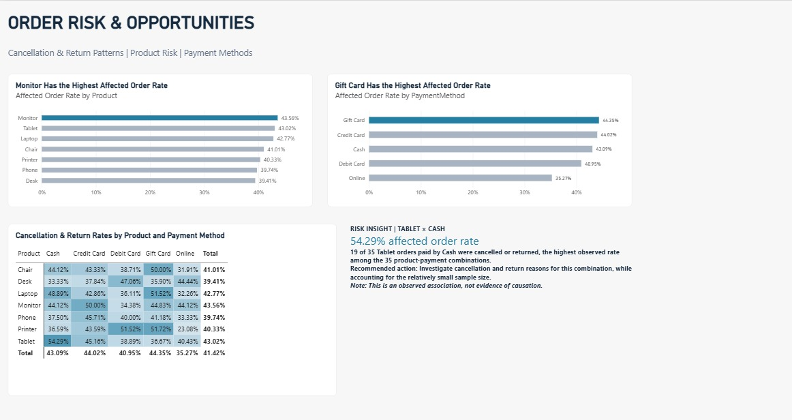

# THE ORDER JOURNEY
### E-Commerce Performance & Risk Intelligence | Power BI Case Study

**DecodeLabs Data Analytics Internship | Project 4: Data Visualization**

> **From order records to business decisions.** An interactive, three-page Power BI experience that connects executive performance, product and customer intelligence, and cancellation and return risk.

## Project at a glance

| Metric | Result |
|:--|--:|
| Recorded orders | **1,200** |
| Total recorded order value | **1,264,761.96** |
| Cancelled or returned orders | **497** |
| Affected order rate | **41.42%** |
| Distinct customers | **1,189** |
| Period analyzed | **January 2023 to June 2025** |

**Business challenge:** Order value alone does not show whether an e-commerce business is healthy. A useful decision-making dashboard also needs to reveal order status, product mix, customer spending, and potential operational friction.

**Project objective:** Transform transactional data into a structured, navigable analytical report that helps stakeholders spot performance patterns, prioritize further investigation, and formulate evidence-based business questions.

## Dashboard experience

### 01 | Executive Pulse
**Question:** What is happening across the order journey?



- Executive KPI cards for recorded order value, order volume, and affected order rate.
- Order-status comparison across cancelled, returned, pending, shipped, and delivered orders.
- Monthly recorded order value trend and a highlighted peak month.

**Insight:** June 2024 recorded the highest monthly order value at **68,068.54**. Meanwhile, **497 of 1,200 orders (41.42%)** were classified as cancelled or returned.

### 02 | Product & Customer Intelligence
**Question:** Which products, customers, and referral sources shape recorded order value?



- Product-level recorded order value comparison.
- Customer spending segmentation using defined spend thresholds.
- Referral-source performance by recorded order value.

**Insights:**
- **Chair (195,620.11)** and **Printer (195,612.61)** lead product recorded order value, with a very small difference between them.
- **Medium Spend** is the largest customer segment, containing **493 customers**.
- **Instagram** has the highest referral-attributed recorded order value at **275,285.45**.

### 03 | Order Risk & Opportunities
**Question:** Where are cancellations and returns concentrated?



- Affected order rate by product and payment method.
- A product-by-payment-method percentage matrix with conditional color formatting.
- A focused investigative insight highlighting the highest observed product-payment intersection.

**Insights:**
- **Monitor** has the highest product-level affected order rate at **43.56%**.
- **Gift Card** has the highest payment-method affected rate at **44.35%**.
- **Tablet × Cash** has the highest observed product-payment affected rate at **54.29%**, representing **19 of 35 orders**. This subgroup is relatively small, so the finding is a signal for investigation, not proof of causation.

## Analytical approach

1. **Understand the order lifecycle:** Examine order counts, order status, dates, recorded order value, product, payment method, and referral source.
2. **Build business metrics:** Create Power BI measures for total orders, total recorded order value, affected orders, and affected order rate.
3. **Summarize customers:** Build a customer-level summary of order count and recorded order value; classify customers into spending segments.
4. **Model the data:** Relate the customer summary to the order table using `CustomerID` in an active, one-to-many relationship with single-direction filtering.
5. **Design the decision journey:** Arrange visuals into an executive overview, performance and customer intelligence, and a focused operational-risk page.
6. **Validate behavior:** Compare headline figures with prior analysis and test report cross-filtering and selection resets.

### Key metric definition

**Affected order rate** = (orders with `OrderStatus` equal to `Cancelled` or `Returned`) / (all recorded orders in the current filter context).

The report uses **recorded order value**, not confirmed or realized revenue. Orders of all statuses are included in the recorded value metric unless a visual states otherwise.

## Recommendations for stakeholders

| Priority | Recommendation | Why it matters |
|:--|:--|:--|
| 1 | Investigate reasons for cancellations and returns, starting with product-payment intersections that show high observed rates. | Helps identify operational questions worth validating with richer data. |
| 2 | Review Monitor-related order outcomes and compare them with other categories. | Monitor has the highest product-level affected rate in this sample. |
| 3 | Analyze payment workflow and customer experience for Gift Card orders. | Gift Card shows the highest affected rate among payment methods, but association is not causation. |
| 4 | Monitor Chair and Printer performance together rather than declaring a decisive winner. | Their recorded order values are nearly equal. |
| 5 | Evaluate referral-source quality using downstream outcomes, not only recorded order value. | A high attributed order value does not, on its own, establish acquisition profitability. |

## Dataset and interpretation notes

- **Scope:** 1,200 recorded orders from January 2023 through June 2025, representing 1,189 distinct customer IDs.
- **Affected:** An order with status `Cancelled` or `Returned`. This classification does not establish when or why the status occurred.
- **Financial interpretation:** Recorded order value should not be presented as realized revenue, net sales, or proven financial loss from cancellations and returns.
- **Customer segments:** Low Spend, Medium Spend, High Spend, and Premium Spend are analyst-defined categories derived from recorded customer order value, not externally validated business tiers.
- **Referral attribution:** The `ReferralSource` field indicates the recorded source; it does not establish marketing incrementality or return on investment.
- **Insight annotations:** Some narrative text on the dashboard is static and describes the unfiltered analysis. It does not automatically update when users filter visuals.
- **Causality and sample size:** The product-payment risk analysis is descriptive. Smaller groups require additional evidence before business interventions.

## Tools and skills

**Microsoft Power BI Desktop**, **Power Query**, **DAX**, data modeling, customer segmentation, interactive reporting, conditional formatting, KPI design, business storytelling, and analytical validation.

## Repository contents

```text
Project4-Data-Visualization/
├── README.md
├── DecodeLabs_Project4_The_Order_Journey.pbix
├── Dataset for Data Analytics (3).xlsx
└── ScreenShots/
    ├── 01_Executive_Pulse.png
    ├── 02_Product_Customer_Intelligence.png
    └── 03_Order_Risk_Opportunities.png
```

## How to explore the report

1. Download `DecodeLabs_Project4_The_Order_Journey.pbix`.
2. Open it using a compatible version of **Power BI Desktop**.
3. Navigate between the three report pages.
4. Select bars or matrix cells to explore cross-filtering where enabled; clear selections to restore the overview.
5. If the original local dataset path is unavailable and a refresh is needed, update the source path in Power Query to the included Excel file.

## What this project demonstrates

The value of this report is not just the visuals. It is the **analytical progression** from overall order performance to customer and product behavior, then to identifiable operational-risk patterns. Each page is designed to answer a more specific business question, while keeping metric definitions and data limitations explicit.

*Prepared as part of the DecodeLabs Data Analytics Internship, Project 4.*
